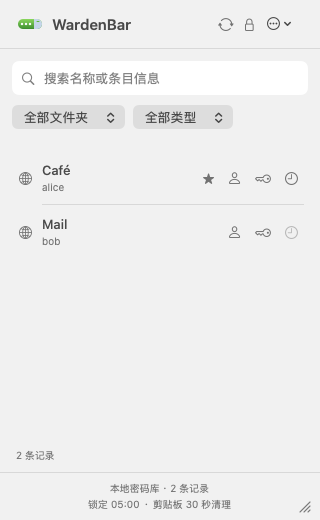
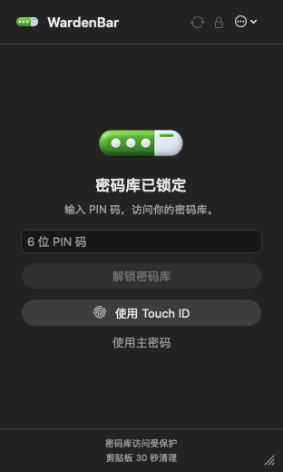

# WardenBar

[简体中文](README.md) | English

A read-only macOS menu bar client for vaults supported by the Bitwarden CLI.

Unlock your vault from the menu bar, search records, and view or copy the fields you need. WardenBar uses the official `bw` CLI as its backend. Compatibility follows the CLI's supported vault services rather than a fixed list of providers; actual sign-in support depends on the CLI, server, and authentication method.

## App preview

<table>
  <tr>
    <td align="center"><br>Search and quick copying</td>
    <td align="center"><br>PIN and Touch ID unlock</td>
  </tr>
</table>

Previews use the actual app UI with synthetic data and contain no real account or vault content.

## Features

- Native SwiftUI / AppKit menu bar interface with no Dock icon.
- Metadata search with folder and record-type filters.
- Personal login, card, identity, secure note, and SSH key records.
- Quick copying of usernames, passwords, and authenticator codes; record details with reveal and copy actions for supported fields and custom fields.
- Local generation of supported TOTP codes during an unlocked session.
- Master password, six-digit PIN, and Touch ID unlock, with quick unlock options managed in Settings.
- Manual sync and lock, idle auto-lock, and locking on screen lock, sleep, and session deactivation.
- An isolated CLI data directory with in-app and terminal sign-in options.

**Vault records are read-only:** the app has no create, edit, delete, or record write-back operations. Sign-in, configuration, and sync can still update local CLI state or caches.

## Requirements

- macOS 13 or later.
- The official [Bitwarden CLI](https://bitwarden.com/help/cli/), available as `bw`.
- A vault account that the CLI can connect to and unlock.

The app interface is currently in Chinese. The GitHub release workflow produces an Apple Silicon (`arm64`) build and does not bundle the Bitwarden CLI. A comprehensive CLI-version, server, and authentication compatibility matrix is not yet available.

## Installation and first use

### 1. Install the Bitwarden CLI

You can install it with Homebrew:

```sh
brew install bitwarden-cli
bw --version
```

See the [official CLI guide](https://bitwarden.com/help/cli/) for other installation methods. An npm installation also requires a working Node.js runtime.

### 2. Install WardenBar

Once a release is available, download `WardenBar-macOS-arm64.zip` from this repository's **Releases** page, extract it, move `WardenBar.app` to **Applications**, and open it from Finder. Alternatively, build from source using the instructions below.

The packaging script currently uses an ad-hoc signature, without Developer ID signing or Apple notarization. macOS may block the first launch of a downloaded build; see [Apple's official guidance](https://support.apple.com/en-us/102445).

### 3. Connect your vault

1. Click the WardenBar menu bar icon.
2. Select a server using the US, EU, or custom server option. Custom servers require HTTPS; HTTP is allowed only for loopback addresses.
3. Enter your email and master password, then complete any supported authenticator, email, YubiKey OTP, or new-device verification prompts.
4. Once unlocked, search, filter, view, and copy records. Manually sync to reflect server-side changes in the app.

For authentication flows the in-app form does not support, switch to terminal sign-in, copy the generated command, complete sign-in in Terminal, and return to the app to check the status. Available methods depend on the installed CLI and server.

WardenBar uses its own CLI data directory by default:

```text
~/Library/Application Support/WardenBar/CLI
```

It does not automatically reuse the default directory of your terminal's `bw` installation. This directory contains the CLI's server configuration, authentication state, and encrypted vault data.

The app searches `PATH` for `bw` and checks `/opt/homebrew/bin/bw` and `/usr/local/bin/bw`. If a Finder launch cannot find a CLI installed elsewhere, provide its absolute path:

```sh
open -a WardenBar --args --cli /absolute/path/to/bw
```

For testing or an isolated profile, fully quit the app before specifying another data directory:

```sh
open -a WardenBar --args --data-dir /absolute/path/to/wardenbar-cli-data
```

## Scope and security boundaries

- Supported personal records are readable. Organization-owned, deleted, master-password-reprompt-protected, and unknown record types are excluded. Attachments and linked custom fields are not supported.
- Record editing, browser autofill, and global keyboard shortcuts are not available.
- While unlocked, supported record fields, passwords, and authenticator seeds remain in an in-memory snapshot. Locking, syncing, and relevant failures revoke snapshot access; this does not guarantee that every Swift memory copy has been zeroed.
- Enabling Touch ID stores an encrypted master-password envelope in the local Keychain. Decryption requires a Secure Enclave private key protected by the current biometric set, and remains available after restarting WardenBar. A Mac with Secure Enclave and Touch ID is required.
- PIN unlock becomes available only after a manual master-password unlock in the current app run. Restarting WardenBar requires another master-password unlock; Touch ID does not enable PIN for that run. Five incorrect PIN attempts also require a master-password unlock to re-enable it.
- The app does not persist the unlock Session or write the plaintext master password to preferences or files. The CLI still stores its own authentication state and encrypted data in the isolated directory above.
- Idle auto-lock defaults to 5 minutes and can be set to 1–1440 minutes or system-events-only locking.
- Copied content expires after 30 seconds by default. Locking also attempts to clear clipboard content still owned by the app. Content replaced by another app is left alone; clipboard managers may retain history.
- Read-only describes the app's current operations, not a server-enforced read-only permission on your account credentials.

WardenBar is an independent community project and is not affiliated with Bitwarden.

## Build from source

Use a full Xcode 26 or newer installation with its command-line tools to compile the Swift app and `.icon` assets. Run these commands from the repository root (`code/` in the local workspace):

```sh
scripts/build-app.sh
open .build/WardenBar.app
```

The script builds a Release app, compiles its icon, checks the minimum macOS version and linked SDK, and verifies an ad-hoc signature. The output is `.build/WardenBar.app`, built for your Mac's native architecture.

Run tests:

```sh
source scripts/env.sh
swift test
```

Tests use synthetic CLI fixtures and native UI checks and do not require a real vault account. Passing tests do not establish compatibility with every real server or authentication flow.

### Touch ID implementation trade-offs

The Secure Enclave envelope supports the current ad-hoc-signed build:

| Aspect | Original: biometric-protected Keychain item | Current: Secure Enclave envelope |
| --- | --- | --- |
| Credential storage | Master password in a protected item | Encrypted envelope in the ordinary Keychain |
| Biometric enforcement | Current biometric set required to read the item | Current biometric set required to use the Secure Enclave private key |
| Build requirements | Data Protection Keychain access must be configured | Works with the current ad-hoc signature without that access |
| Trade-off | Simpler storage logic | More encryption logic; a separate Keychain access prompt may appear |

Both designs enforce biometric access through the system; Keychain access approval cannot replace biometric decryption.
