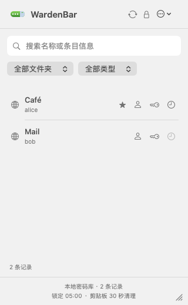
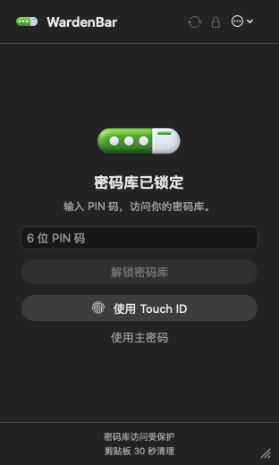

# WardenBar

简体中文 | [English](README-en.md)

通过 Bitwarden CLI 访问兼容密码库的 macOS 菜单栏只读客户端。

在菜单栏解锁密码库，搜索记录，查看和复制所需字段。WardenBar 使用官方 `bw` CLI 作为后端，面向其支持的密码库服务；兼容范围不限定于 Bitwarden 或 Vaultwarden 两个名称，实际登录能力取决于 CLI、服务器和认证方式。

## 应用预览

<table>
  <tr>
    <td align="center"><br>搜索与快捷复制</td>
    <td align="center"><br>PIN 码与 Touch ID 解锁</td>
  </tr>
</table>

预览由实际应用界面配合合成数据生成，不含真实账号或密码库内容。

## 功能

- 原生 SwiftUI / AppKit 菜单栏界面，不占用 Dock。
- 搜索记录元数据，按文件夹和记录类型筛选。
- 查看个人密码库中的登录、支付卡、身份、安全笔记和 SSH 密钥记录。
- 快速复制用户名、密码和动态验证码，查看、显示和复制记录详情及支持的自定义字段。
- 在解锁会话内本地生成支持的 TOTP 验证码。
- 主密码、6 位 PIN 码和 Touch ID 解锁，可在「设置」中管理快速解锁方式。
- 手动同步、手动锁定、闲置自动锁定，以及屏幕锁定、睡眠和会话失活时锁定。
- 独立的 CLI 数据目录，以及应用内登录和终端登录入口。

**密码库条目只读**：没有新增、编辑、删除或回写条目的功能。登录、配置和同步仍会更新本地 CLI 状态或缓存。

## 使用要求

- macOS 13 或更新版本。
- 已安装官方 [Bitwarden CLI](https://bitwarden.com/help/cli/)，命令为 `bw`。
- CLI 能连接并解锁的密码库账号。

当前应用界面为中文。GitHub 发布工作流生成 Apple Silicon（`arm64`）包，不包含 Bitwarden CLI。项目尚未建立完整的 CLI 版本、服务器和登录方式兼容矩阵。

## 安装与开始使用

### 1. 安装 Bitwarden CLI

可以通过 Homebrew 安装：

```sh
brew install bitwarden-cli
bw --version
```

其他安装方式见 [CLI 官方说明](https://bitwarden.com/help/cli/)。使用 npm 安装时，也需要可用的 Node.js。

### 2. 安装 WardenBar

有发布版本后，从仓库的 **Releases** 页面下载 `WardenBar-macOS-arm64.zip`，解压并将 `WardenBar.app` 放入「应用程序」，然后从 Finder 打开。也可以按下方步骤从源码构建。

当前打包脚本只使用临时签名（ad-hoc），没有 Developer ID 签名和 Apple 公证。下载的应用首次启动时可能被 macOS 拦截；相关处理见 [Apple 官方说明](https://support.apple.com/en-us/102445)。

### 3. 连接密码库

1. 点击菜单栏中的 WardenBar 图标。
2. 选择服务器；内置美国、欧洲和自定义服务器入口。自定义地址要求 HTTPS，仅本机回环地址允许 HTTP。
3. 输入邮箱和主密码，按需完成身份验证器、邮件或 YubiKey OTP 验证，以及支持的新设备验证提示。
4. 解锁后搜索、筛选、查看和复制记录。服务器上的更改需要手动同步后反映到应用中。

遇到应用内未支持的认证流程时，可以切换到「终端登录」，复制应用生成的登录命令，在终端完成登录后返回应用检查状态。具体可用方式取决于所安装 CLI 和服务器。

WardenBar 默认使用独立目录：

```text
~/Library/Application Support/WardenBar/CLI
```

它不会自动沿用终端 `bw` 的默认登录目录。该目录保存 CLI 的服务器配置、认证状态和加密密码库数据。

应用会查找 `PATH` 中的 `bw`，并检查 `/opt/homebrew/bin/bw` 和 `/usr/local/bin/bw`。若 Finder 启动时找不到自定义位置的 CLI，可以显式指定绝对路径：

```sh
open -a WardenBar --args --cli /absolute/path/to/bw
```

测试或隔离配置时，可在应用完全退出后指定另一数据目录：

```sh
open -a WardenBar --args --data-dir /absolute/path/to/wardenbar-cli-data
```

## 支持范围与安全边界

- 目前读取受支持的个人记录；组织记录、已删除记录、要求重新输入主密码的记录和未知记录类型不显示。不支持附件和关联型自定义字段。
- 没有条目编辑、浏览器自动填充或全局快捷键功能。
- 解锁期间，受支持记录的字段、密码和验证码种子保存在应用内存快照中。锁定、同步和相关失败会撤销快照访问；这不等同于保证 Swift 内存中的所有副本已被清零。
- 启用 Touch ID 后，主密码以加密封装形式保存在本机 Keychain，解密需由当前指纹集合保护的 Secure Enclave 私钥完成；重启 WardenBar 后仍可使用。需要支持 Secure Enclave 和 Touch ID 的 Mac。
- PIN 码仅在本次运行中手动使用主密码解锁后可用；重启 WardenBar 后需重新使用主密码解锁，Touch ID 解锁不会启用本次运行的 PIN。连续输错 5 次后，也需使用主密码重新启用。
- 应用不持久化解锁 Session，也不将主密码明文写入偏好设置或文件；CLI 仍会在上述独立目录保存自己的认证状态和加密数据。
- 默认闲置 5 分钟后锁定，可设置为 1–1440 分钟或仅跟随系统事件锁定。
- 复制内容默认 30 秒后清除；锁定时也会尝试清除仍由应用持有的剪贴板内容。已被其他应用替换的内容不会被清除，剪贴板管理器可能保留历史。
- “只读”描述当前应用的操作范围，不代表账号凭据获得了服务器端的只读权限。

WardenBar 是独立社区项目，与 Bitwarden 无隶属关系。

## 从源码构建

需要完整的 Xcode 26 或更新版本及其命令行工具，以编译 Swift 应用和 `.icon` 图标资源。以下命令在仓库根目录运行（本地工作区中为 `code/`）：

```sh
scripts/build-app.sh
open .build/WardenBar.app
```

脚本构建 Release 应用、编译图标、检查最低系统版本及实际链接 SDK，并进行临时签名验证。输出为 `.build/WardenBar.app`，使用当前 Mac 的本机架构。

运行测试：

```sh
source scripts/env.sh
swift test
```

测试包含合成 CLI 夹具和原生界面检查，不需要真实密码库账号。通过测试不代表所有真实服务器和认证流程均已验证。

### Touch ID 实现取舍

为兼容当前临时签名构建，采用 Secure Enclave 加密封装方案：

| 对比 | 原定：受指纹保护的 Keychain 条目 | 当前：Secure Enclave 加密封装 |
| --- | --- | --- |
| 凭据存储 | 主密码存入受保护条目 | 普通 Keychain 存储加密封装 |
| 指纹约束 | 读取条目时校验当前指纹集合 | 使用 Secure Enclave 私钥时校验当前指纹集合 |
| 构建要求 | 需配置 Data Protection Keychain 权限 | 兼容当前 ad-hoc 签名，无需该权限 |
| 取舍 | 存取逻辑较简单 | 加密逻辑较多，可能另有钥匙串访问授权提示 |

两种方案都由系统强制执行指纹约束；钥匙串访问授权不能替代指纹解密。
